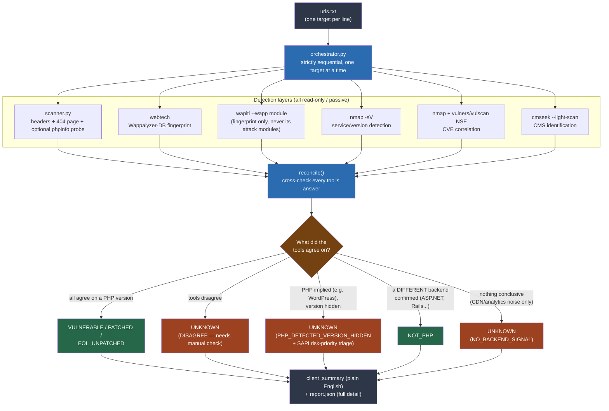

# php2shell-scanner

A small, multi-tool, **passive-only** scanner for **CVE-2026-109618** and
**CVE-2026-109619** — the PHP core memory-corruption RCE pair disclosed
2026-10-21 (fixed in PHP **8.2.35 / 8.3.36 / 8.4.27 / 8.5.12**).

It answers one question as reliably as possible without ever touching the
actual bug: **is this specific PHP version installed on this target?**
It does that by running six independent, well-known detection tools
against each target and cross-checking their answers against each other,
instead of trusting any single banner grab.

## ⚠️ Disclaimer — read this first

**This tool is for authorized security testing and defensive research
only.** Only run it against systems you own, or systems you have
explicit, documented authorization to test (a client engagement, a
bug-bounty scope, your own infrastructure, a CTF). Running network scans
against systems without authorization is illegal in most jurisdictions
and a violation of most hosting providers' terms of service.

This project is published so other defenders and security researchers
can quickly and safely find out whether their own (or their clients')
PHP infrastructure is exposed to this specific CVE pair, so they can
patch it — **not** to help anyone exploit it. The author accepts no
responsibility for misuse. If you want the actual exploit, this is not
it, and you won't find help building one here either.

---

## What this is (and isn't)

**Is:** a passive detection and cross-checking pipeline. Every request it
sends is an ordinary GET a browser would also send, or a single
light-footprint fingerprint request from a well-known tool. Nothing here
sends oversized payloads, aborts PHP-FPM workers, or attempts to trigger
the actual out-of-memory/use-after-free condition the CVEs describe.

**Isn't:** an exploit, a PoC, or a vulnerability scanner in the Nikto/
Wapiti-attack-module sense. It cannot *prove* a target is exploitable —
only the real OOM-trigger chain can do that, and that risks crashing a
production PHP-FPM pool, which is explicitly out of scope here. For
hosts that hide their PHP version entirely, the honest answer is
"ask the owner" — and this tool says so, instead of guessing.

## Why six tools instead of one

A single header check is one data point that's trivially hidden by any
reasonably configured server. Running several independent, well-known
tools and requiring them to agree catches a surprising number of
real-world edge cases — including one found during development: a
WordPress site with no literal "PHP" tag from any single tool very
nearly got misclassified as "not running PHP at all." Cross-checking is
what catches that kind of mistake before it reaches a client report.

## Architecture



## Features

- **Six independent detection layers**, cross-checked against each other
  before any verdict is reported
- **Strictly sequential** scanning — one target at a time, always, with a
  configurable delay — there is no concurrency flag and none will be
  added, by design
- **Plain-English `client_summary`** per target — safe to paste directly
  into a report for a non-technical stakeholder
- **CMS-aware**: recognizes that WordPress/Joomla/Drupal/Magento/Laravel/
  etc. *are* PHP even when no tool's fingerprint database explicitly
  tags "PHP"
- **SAPI-based risk triage** for hidden-version targets, sourced directly
  from the two PHP security advisories' own text — not a guess (see
  [Security advisory grounding](#security-advisory-grounding))
- **Pre-flight tool check** — a missing/misconfigured tool fails loudly
  before scanning, not silently mid-run
- **Per-layer timing** in the JSON report, so a suspiciously-fast "result"
  is visible as evidence, not hidden
- Zero required cloud services or API keys for the core detection path

## Installation

### Python dependencies
```bash
pip install -r requirements.txt
```

### External tools
This project orchestrates existing, well-known tools rather than
reimplementing detection logic. Install what you want to use; each layer
degrades gracefully (reported as `SKIPPED` or excluded, never a crash) if
a given tool isn't installed, except where noted.

| Tool | Install | Notes |
|---|---|---|
| [nmap](https://nmap.org/download.html) | OS package manager / installer | Required for layers 4–5. The script auto-detects whether `vulners`/`vulscan` NSE scripts are installed and skips them gracefully if not. |
| [webtech](https://github.com/ShielderSec/webtech) | `pip install webtech` | Required for layer 2. |
| [Wapiti3](https://wapiti.sourceforge.io/) | `pip install wapiti3` | Required for layer 3. **Known Windows issue**: its `cffi`/`zstandard` deps may fail to build on very new Python versions. If so, install it into a venv under an older Python (3.11–3.13) instead — no code changes needed, just point `PHP2SHELL_WAPITI_PATH` at that venv's `wapiti` executable. |
| [vulners NSE](https://github.com/vulnersCom/nmap-vulners) | `git clone` into nmap's `scripts/` directory, then `nmap --script-updatedb` | Optional. Online CVE correlation by detected version. |
| [vulscan NSE](https://github.com/scipag/vulscan) | `git clone` into nmap's `scripts/` directory, same `--script-updatedb` | Optional. Offline CVE correlation; refresh its bundled CSVs yourself for current data. On Windows, nmap's script.db matcher needs the vulscan script's **full path**, not its bare name — set `PHP2SHELL_VULSCAN_NSE_PATH` to that full path. |
| [CMSeeK](https://github.com/Tuhinshubhra/CMSeeK) | `git clone`, then `pip install -r requirements.txt` inside it | Required for layer 6. Despite its own README saying "Unix-based systems only for now," it runs fine on Windows too. |

### Pointing the script at your installs
Each tool's path is resolved in this order: an environment variable
override → `PATH` lookup → (Windows only) a couple of common install
locations. Nothing is hardcoded to any one machine.

```bash
# Only needed if a tool isn't already on PATH:
export PHP2SHELL_NMAP_PATH="/usr/bin/nmap"
export PHP2SHELL_WAPITI_PATH="/path/to/wapiti"
export PHP2SHELL_WEBTECH_PATH="/path/to/webtech"
export PHP2SHELL_CMSEEK_PATH="/path/to/CMSeeK/cmseek.py"
export PHP2SHELL_VULSCAN_NSE_PATH="/path/to/nmap/scripts/vulscan/vulscan.nse"
```

Run `python orchestrator.py --help` — the pre-flight check it prints
first will tell you exactly which tools it found and which env var to set
for any it didn't.

### Linux quickstart example
The path-resolution logic itself needs no Linux-specific code (the
Windows fallback paths are explicitly gated out on other platforms, and
`PATH` lookup works the same everywhere) — but two real Linux-specific
gotchas are worth calling out up front:

1. **Newer Debian/Ubuntu (PEP 668) reject a bare `pip install`** outside
   a virtual environment ("externally managed environment" error). Use a
   venv, as below.
2. **nmap's `scripts/` directory is root-owned** on a typical Linux
   install, same as `Program Files` is on Windows — installing the
   optional `vulners`/`vulscan` NSE scripts needs `sudo`.

```bash
# 1. System packages
sudo apt update && sudo apt install -y nmap python3 python3-venv git

# 2. Python deps in a venv — this also puts wapiti/webtech on PATH
#    automatically once activated, no env var needed for those two
python3 -m venv ~/.venvs/php2shell
source ~/.venvs/php2shell/bin/activate
pip install -r requirements.txt
pip install webtech wapiti3

# 3. CMSeeK — not pip-installable, clone it and point the scanner at it
git clone https://github.com/Tuhinshubhra/CMSeeK ~/tools/CMSeeK
pip install -r ~/tools/CMSeeK/requirements.txt
export PHP2SHELL_CMSEEK_PATH="$HOME/tools/CMSeeK/cmseek.py"

# 4. Optional: vulners/vulscan NSE scripts (needs sudo; skip this step
#    entirely and the scanner just runs nmap without them — see "Info-
#    gathering + CVE-correlation scripts" note in orchestrator.py)
sudo git clone https://github.com/vulnersCom/nmap-vulners.git /usr/share/nmap/scripts/vulners
sudo git clone https://github.com/scipag/vulscan.git /usr/share/nmap/scripts/vulscan
sudo nmap --script-updatedb
export PHP2SHELL_VULSCAN_NSE_PATH="/usr/share/nmap/scripts/vulscan/vulscan.nse"

# 5. Run it (re-activate the venv in any new shell session first)
source ~/.venvs/php2shell/bin/activate
cp urls.txt.example urls.txt   # then edit with your real, authorized targets
python orchestrator.py urls.txt --json report.json
```

Only `PHP2SHELL_CMSEEK_PATH` and (optionally) `PHP2SHELL_VULSCAN_NSE_PATH`
need setting here — `nmap`, `wapiti`, and `webtech` all resolve
automatically via `PATH` once installed this way. Add the `export` lines
to your shell profile (`~/.bashrc`/`~/.zshrc`) if you don't want to
re-export them every session.

## Usage

```bash
cp urls.txt.example urls.txt   # then edit it with your real, authorized targets
python orchestrator.py urls.txt --json report.json
```

Options:
- `--check-phpinfo` — also probe common phpinfo-exposure paths (default off)
- `--skip-nmap` / `--skip-wapiti` / `--skip-cmseek` — drop a layer
- `--cmseek-deepscan` — use CMSeeK's deep scan (plugin/theme/user
  enumeration, backup-file finder, admin-page finder, config-leak
  detection) instead of its default light-scan. This actively probes many
  paths per target — meaningfully more intrusive than everything else in
  this pipeline. Run it one target at a time, never across a full list.
- `--delay N` — seconds between targets, default 3.0 (always sequential)

`scanner.py` can also be run completely standalone if you only want the
single header/404/phpinfo check without the other five layers:
```bash
python scanner.py urls.txt --json report.json
```

## Reading the report

Each target in `report.json` has:

- **`overall_status`** — one of:
  - `VULNERABLE` — confirmed version below the fix for its branch
  - `PATCHED` — confirmed version at/above the fix
  - `EOL_UNPATCHED` — end-of-life PHP branch, won't get a backport, needs
    upgrading regardless
  - `NOT_PHP` — a genuinely different backend platform was confirmed
    (ASP.NET, Node, Rails, Spring, etc.)
  - `UNKNOWN` — see `version_agreement` for why: no signal at all, PHP
    detected/implied but version hidden, or tools disagreeing (never
    treat this as "probably safe")
- **`version_agreement`** — the short machine-readable reason behind an
  `UNKNOWN`/`NOT_PHP` result
- **`php_versions_seen`** — exactly which of the four version-capable
  tools found what, so you can see agreement/disagreement yourself
- **`detected_technologies`** — the full tech stack each tool
  fingerprinted, not just PHP (CMS, framework, web server, CDN, etc.)
- **`client_summary`** — one plain-English sentence, safe to paste
  directly into a report for a non-technical reader
- **`sapi_priority`** — `HIGH_PRIORITY` / `MEDIUM_PRIORITY` /
  `LOWER_PRIORITY` / `N/A`, a triage aid for hidden-version targets (see
  below) — **not** a vulnerability verdict

## Security advisory grounding

Everything in the "why not just try to trigger it" and the SAPI
risk-priority logic comes directly from the two upstream PHP security
advisories, not guesswork:
- [GHSA-w8hw-w9fx-j79w](https://github.com/php/php-src/security/advisories/GHSA-w8hw-w9fx-j79w) (CVE-2026-109618)
- [GHSA-6wmf-4rv5-p3rp](https://github.com/php/php-src/security/advisories/GHSA-6wmf-4rv5-p3rp) (CVE-2026-109619)

Both advisories state explicitly that there is **no safe, non-crashing
way to confirm exploitability remotely** beyond comparing the installed
version against the fixed releases, and both explicitly warn against
sending the kind of crafted requests that would actually test the real
condition. This tool respects that boundary completely. The SAPI
risk-priority field (`HIGH_PRIORITY` for Apache/mod_php, `MEDIUM_PRIORITY`
for nginx+PHP-FPM/LiteSpeed, `LOWER_PRIORITY` for FrankenPHP) reflects
each advisory's own "affected configurations" section — it tells you
*which hidden-version target to chase a PHP version for first*, nothing
more.

## What this deliberately does not do

- No OOM-trigger probes, no oversized multipart uploads, no PHP-FPM
  worker-abort cycling — the actual exploit chain for these CVEs, which
  risks crashing production infrastructure. Several public "PoC" repos
  for this CVE pair do exactly this; this project does not.
- No active exploitation modules from Nikto or Wapiti (their crawling,
  injection, and brute-force modules) by default. Only Wapiti's passive
  `wapp` fingerprint module is used.
- No reliance on unverified third-party "detection" repos. Several
  appeared within days of disclosure under anonymous accounts, giving
  mutually contradictory descriptions of the bug — a classic pattern for
  low-quality or malicious content riding a trending CVE's name. None of
  that was used in building this.

## Known limitations

- Cannot confirm exploitability on a hidden-version target — only the
  vendor's own (destructive) test could, and this project won't go there.
- Linux distributions sometimes backport security fixes without changing
  PHP's own reported version string. A version banner that looks
  unpatched may already be fixed upstream in the distro's build — always
  check the vendor/distro's own advisory for your platform when in doubt.
- CMS-core-version detection (CMSeeK, webtech, Wapiti's `wapp` module) is
  **not** PHP-interpreter-version detection — no tool, including WPScan,
  detects that. It only helps recognize that a target *is* PHP.
- `vulscan`'s offline CVE database is only as current as when you last
  refreshed it.

## Credits

Built on top of these excellent existing tools — all credit for the
underlying detection techniques goes to their respective authors:
[nmap](https://nmap.org/), [Wapiti](https://wapiti.sourceforge.io/),
[webtech](https://github.com/ShielderSec/webtech),
[CMSeeK](https://github.com/Tuhinshubhra/CMSeeK),
[nmap-vulners](https://github.com/vulnersCom/nmap-vulners),
[vulscan](https://github.com/scipag/vulscan). The PHP security team for
the advisories this tool's risk logic is grounded in.

## License

MIT — see [LICENSE](LICENSE).
